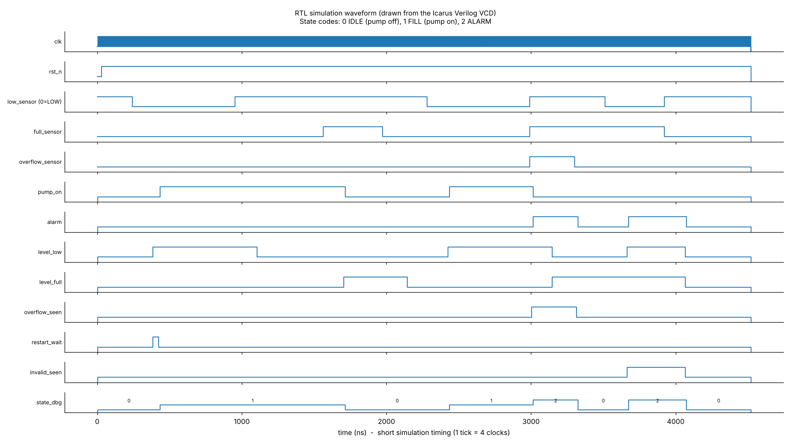
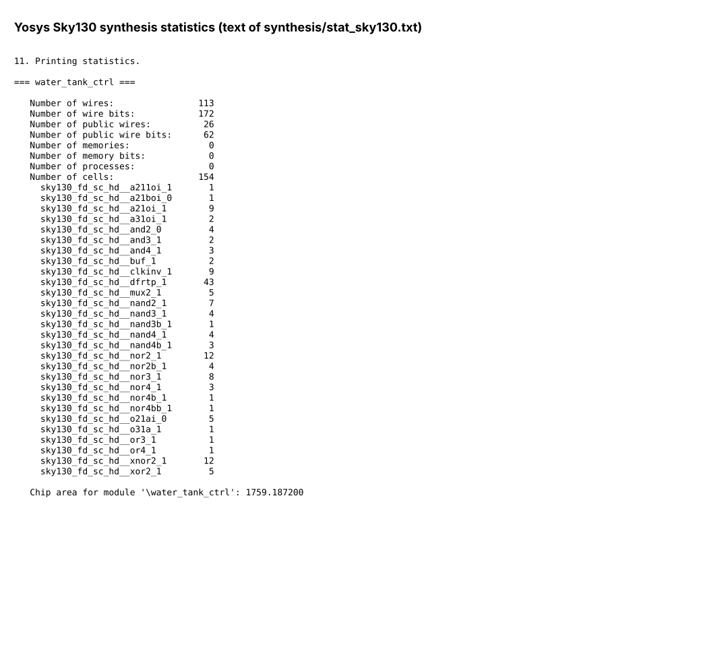
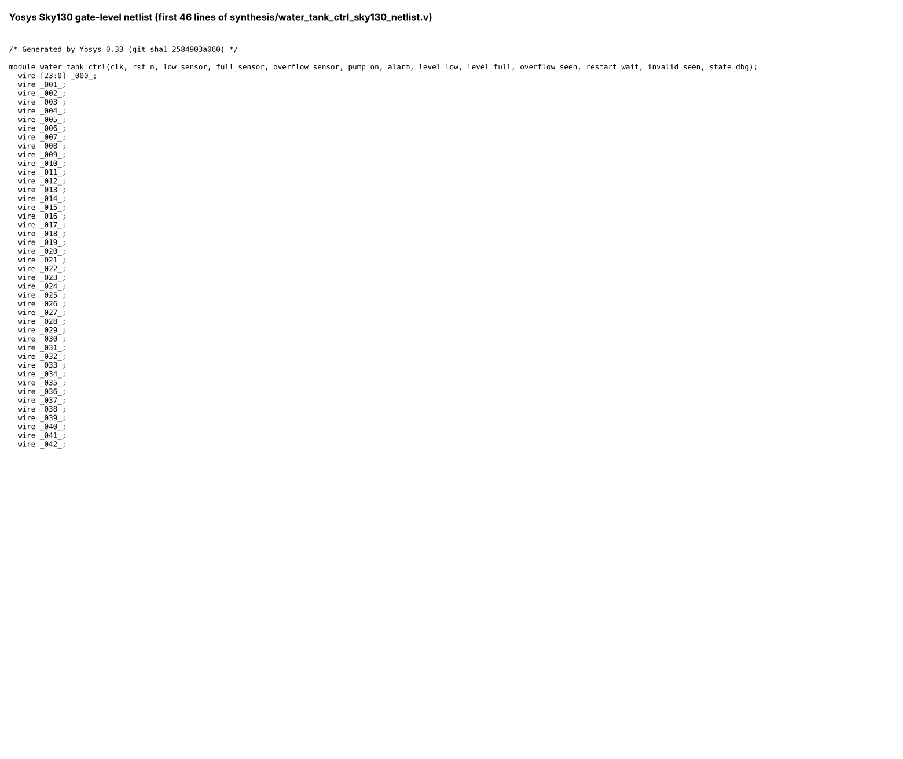
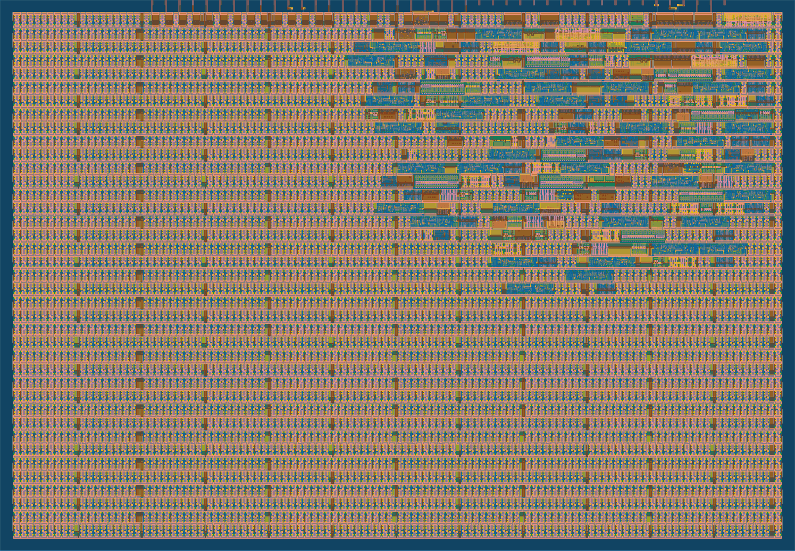

# Smart Water Tank Pump Controller with Overflow Protection – Assessment 1

**Student:** M. Vamshi Krishna  |  **Roll number:** 24EG104E41

## Introduction

This folder contains the work for Assessment 1: the design, simulation, synthesis, gate-level simulation and physical implementation (GDS) of a **smart water tank pump controller with overflow protection**, written in Verilog HDL.

It is an educational design. It has not been fabricated and it is not meant to drive a real pump directly (a real pump needs an isolated driver and protection).

The layout was generated by the Tiny Tapeout cloud workflow. The branch that holds the workflow run is here: https://github.com/mudidenivamshi/RTL_DESIGN_WORKSHOP_VAMSHI/tree/gds-run

## Objectives

- Design a water tank pump controller as a finite state machine (FSM) in Verilog HDL.
- Start the pump when the tank is LOW, keep its state between LOW and FULL, and stop it at FULL.
- Stop the pump and raise an alarm on overflow or on an impossible sensor reading.
- Ignore water ripple on the sensors (debounce) and avoid rapid pump restarts (restart lockout).
- Verify the design with a self-checking testbench and mutation testing.
- Generate and analyse waveforms from the simulation.
- Synthesise the design with Yosys.
- Run a gate-level simulation (GLS) and compare it with the RTL.
- Generate a GDS layout and check DRC, LVS and timing.

## Tools and Technologies

Verilog HDL, Icarus Verilog 12.0, Verilator 5.020, cocotb 2.1.0, Yosys 0.33, Python (matplotlib) for drawing waveform images, Tiny Tapeout flow (LibreLane: OpenROAD, Magic, KLayout, Netgen), SKY130 PDK, Git and GitHub Actions.

## Table of Contents

1. [Controller Design](#1-controller-design)
2. [RTL Simulation](#2-rtl-simulation)
3. [Waveform Analysis](#3-waveform-analysis)
4. [RTL Synthesis](#4-rtl-synthesis)
5. [Gate-Level Simulation](#5-gate-level-simulation)
6. [RTL vs GLS Comparison](#6-rtl-vs-gls-comparison)
7. [Physical Design and GDS](#7-physical-design-and-gds)
8. [Overall Result](#8-overall-result)
9. [Limitations](#9-limitations)
10. [Conclusion](#10-conclusion)

## 1. Controller Design

The controller is a 3-state Moore FSM (IDLE, FILL, ALARM) with a clock prescaler, input synchronisers, a debounce block and a restart-lockout counter.

| Water condition | Pump | Alarm |
|---|---|---|
| Below LOW (after the restart lockout) | ON | OFF |
| Between LOW and FULL | keeps its previous state | OFF |
| FULL | OFF | OFF |
| Overflow | OFF | ON |
| FULL without LOW (impossible reading) | OFF | ON |

**Inputs:** `clk`, `rst_n`, `low_sensor` (0 = tank LOW), `full_sensor`, `overflow_sensor`
**Outputs:** `pump_on`, `alarm`, `level_low`, `level_full`, `overflow_seen`, `restart_wait`, `invalid_seen`, `state_dbg[1:0]`

Design files (inside the `project` folder):

- `project/src/water_tank_ctrl.v` – the design
- `project/src/project.v` – Tiny Tapeout wrapper
- `project/verification/tb_water_tank_ctrl.v` – self-checking testbench
- `project/synthesis/water_tank_ctrl_sky130_netlist.v` – synthesised netlist
- `project/physical_design/tt_um_water_tank_ctrl.gds` – layout

## 2. RTL Simulation

The RTL was simulated with Icarus Verilog using a self-checking testbench with 15 directed tests (T01 to T15) and automatic monitors. The tests cover reset, power-on lockout, hysteresis, restart lockout, overflow, invalid sensor combination, glitch rejection, reset during operation, illegal-state recovery, repeated fill cycles, a closed-loop tank model and random stress.

| Check | Result |
|---|---|
| Self-checking testbench | 486,759 checks, 0 errors |
| Mutation test (18 injected bugs) | all 18 caught |
| Production-timing smoke test | pump starts 100,000,001 clocks (10 s at 10 MHz) after reset with the tank LOW |
| cocotb tests | 6 of 6 passed |

Run it with `make sim` inside `project`. The log is `project/verification/sim_log.txt`.

## 3. Waveform Analysis

The waveform below was drawn by a script (`project/gls/make_waveforms.py`) from the simulation VCD file. It is not a GTKWave screenshot. State codes: 0 IDLE, 1 FILL, 2 ALARM. `low_sensor` = 0 means the tank is LOW.

### RTL Waveform

## 4. RTL Synthesis

The RTL was synthesised with Yosys 0.33 to the SKY130 high-density cell library.

| Item | Result |
|---|---|
| Standalone Yosys run | 154 cells, 43 flip-flops, 1759.2 µm² |
| Synthesis inside the Tiny Tapeout flow | 180 cells, 43 flip-flops, 2258.4 µm² |

### Synthesis statistics

### Gate-level netlist (first lines)

## 5. Gate-Level Simulation

The same RTL was synthesised again with the short simulation timing and simulated side by side with the RTL using identical inputs (`project/gls/`). This GLS uses Yosys generic gates with zero delay, not the SKY130 cells with real delays.

### GLS Waveform

## 6. RTL vs GLS Comparison

All outputs were compared on every clock: **69,136 clock samples compared, 0 mismatches** (`project/gls/rtl_vs_gls_log.txt`). The stimulus is a scripted scenario followed by random sensor changes and resets. The comparison was also run against a deliberately broken RTL and then reported thousands of mismatches, so it is able to fail. The picture below shows the scripted part.

## 7. Physical Design and GDS

The layout was produced with the Tiny Tapeout GitHub Action (LibreLane) on the sky130A process, with a 20 ns target clock.

| Item | Result |
|---|---|
| Die size | 161.0 µm × 111.52 µm |
| Standard-cell area | 3180.55 µm² (459 cells, 19.3 % utilisation) |
| Setup slack (worst corner / typical) | +9.75 ns / +13.65 ns |
| Hold slack (worst corner) | +0.105 ns |
| Timing violations | 0 across 9 corners |
| Magic DRC | 0 violations |
| Tiny Tapeout precheck | 15 of 15 passed |
| LVS | circuits match uniquely |
| Antenna | 0 violating nets |
| Estimated power | about 264 µW (a static estimate, not measured) |

Reports are in `project/physical_design/reports/`. The only failed cloud job was the optional 3D viewer, because GitHub Pages was not enabled; it does not affect the layout or the checks.

## 8. Overall Result

The controller was designed, verified, synthesised, checked by gate-level simulation and taken to a GDS layout with clean design-rule, layout-versus-schematic and timing checks. The RTL and GLS results agree for the tested sequence.

## 9. Limitations

- Educational design; not for driving a real pump directly. No dry-run or pump-fault detection and no maximum-run timer.
- The testbench does not prove every possible input sequence.
- The gate-level simulation uses zero-delay generic gates; the gate-level test inside the Tiny Tapeout flow only checks the reset state.
- No chip was fabricated and the power value is a tool estimate.
- Slack is measured against a 20 ns constraint; it does not show the maximum frequency. The flow used 9 timing corners.
- A one-clock overflow glitch gives a one-clock alarm pulse; the pump is held off through the restart lockout.

## 10. Conclusion

Assessment 1 demonstrates the complete flow from a clearly defined application to a verified Verilog design, a synthesised netlist, a gate-level simulation that matches the RTL, and a GDS layout.
